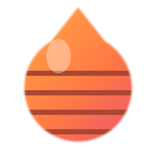
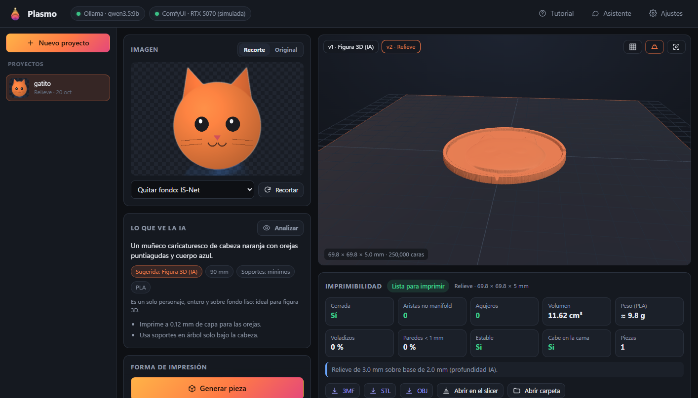
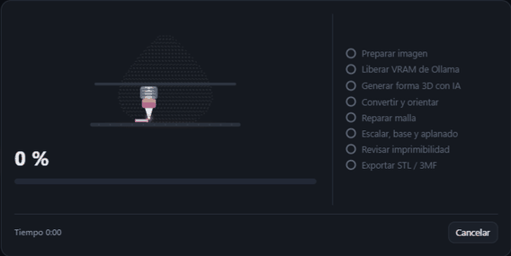
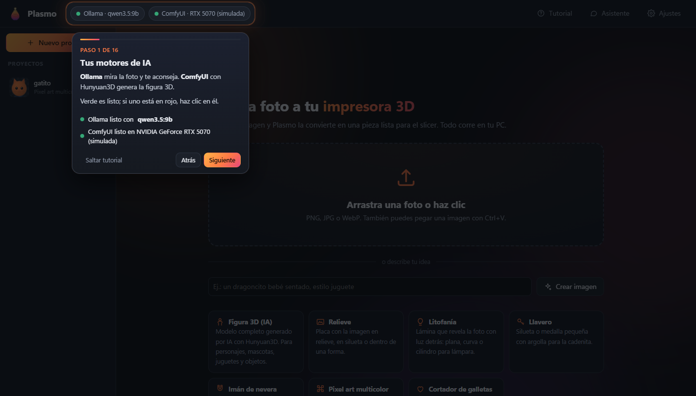
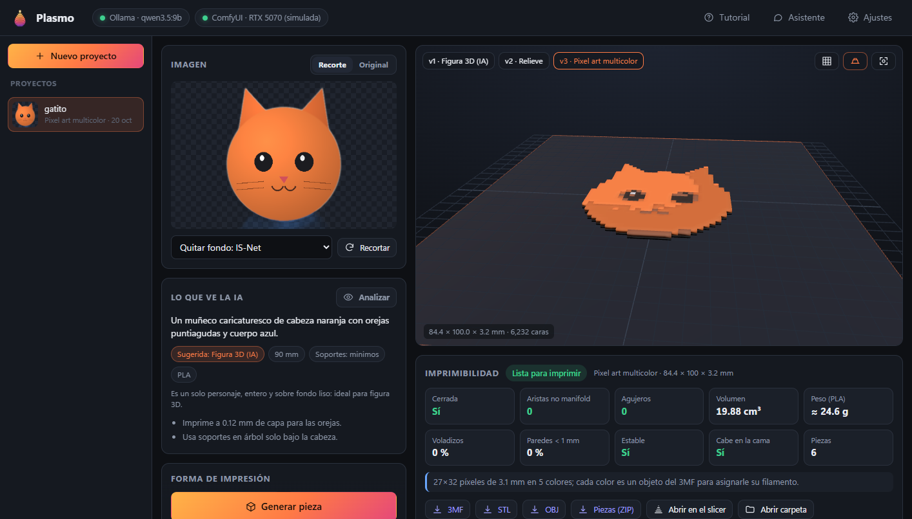
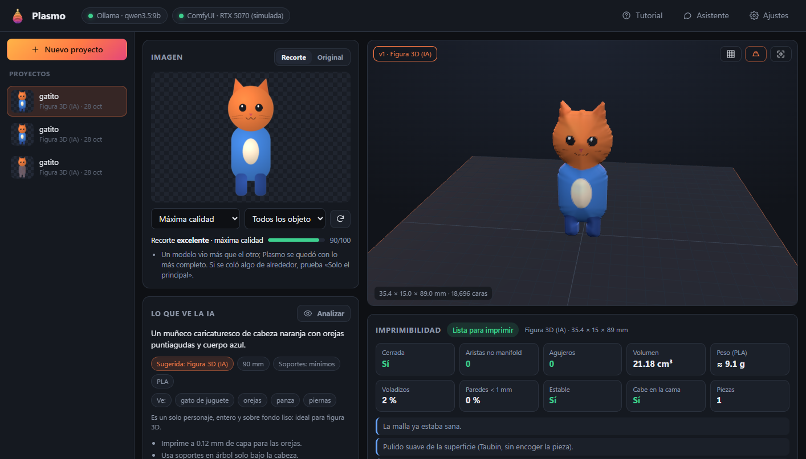
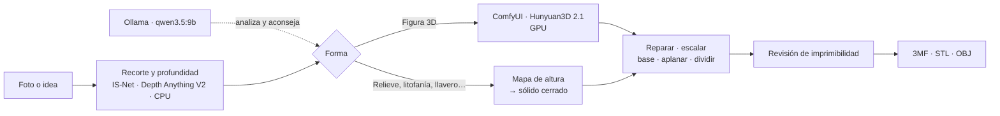

<div align="center">



# Plasmo

**De una foto a tu impresora 3D.**<br>
Sube una imagen y recibe una pieza lista para el slicer. Funciona 100 % en tu PC con Ollama, ComfyUI y Hunyuan3D.

[](https://github.com/RandyGrullon/Plasmo/actions/workflows/ci.yml)
[](https://github.com/RandyGrullon/Plasmo/releases/latest)
[](LICENSE)


[**Descargar**](https://github.com/RandyGrullon/Plasmo/releases/latest) ·
[Instalar la IA](docs/INSTALAR-IA.md) ·
[Investigación](docs/INVESTIGACION.md) ·
[Reportar un problema](https://github.com/RandyGrullon/Plasmo/issues)



</div>

---

## Contenido

- [¿Qué es Plasmo?](#qué-es-plasmo)
- [Características](#características)
- [Capturas](#capturas)
- [Inicio rápido](#inicio-rápido)
- [Requisitos](#requisitos)
- [Cómo funciona](#cómo-funciona)
- [Calidad medida](#calidad-medida)
- [Formas de impresión](#formas-de-impresión)
- [Modelos de IA](#modelos-de-ia)
- [Configuración](#configuración)
- [Desarrollo](#desarrollo)
- [Hoja de ruta](#hoja-de-ruta)
- [Preguntas frecuentes](#preguntas-frecuentes)
- [Licencias y créditos](#licencias-y-créditos)

## ¿Qué es Plasmo?

Plasmo es una aplicación de escritorio para Windows que convierte fotos en piezas imprimibles: figuras 3D generadas por IA, relieves, litofanías, llaveros, imanes, pixel art multicolor y cortadores de galletas.

Es una alternativa personal y gratuita a [Meshy](https://www.meshy.ai/), pensada solo para **impresión 3D**:

- **Sin nube.** No hay créditos ni suscripciones, y tus imágenes nunca salen de tu PC.
- **Lista para el slicer.** Cada pieza sale cerrada, revisada y medida en milímetros, en STL o 3MF.
- **Liviana.** Plasmo no carga PyTorch: habla por HTTP con Ollama y ComfyUI, y cada motor se actualiza por su lado.

## Características

| | |
|---|---|
| 🧠 **Ve la foto** | Ollama (`qwen3.5:9b`) describe la imagen y sugiere la forma, el tamaño, los soportes y el material, con respuesta JSON validada. |
| 🗿 **Figura 3D con IA** | Hunyuan3D 2.1 en ComfyUI con calidad **Máxima** por defecto (malla de 512 y 50 pasos). Plasmo arma el grafo y sigue el progreso paso a paso por WebSocket. |
| 🎨 **Igual a la foto, también en color** | Proyecta los colores de la foto sobre la figura, alineando la silueta de la malla con la del recorte. La espalda toma el color de cada zona sin los rasgos del frente. Sale en la vista previa y en un **OBJ a color** que Bambu Studio y OrcaSlicer pasan a filamentos. |
| 🖼️ **Seis formas sin GPU** | Relieve, litofanía (plana, curva o lámpara), llavero, imán, pixel art multicolor y cortador. Salen de un generador de sólidos que siempre da mallas cerradas. |
| ✂️ **Detecta todo el sujeto** | Combina IS-Net y BiRefNet, cada uno con doble pasada (foto y espejo), sin deformar la proporción. Un filtro guiado por los colores de la foto ajusta los bordes, conserva **todos** los objetos (solo quita motas) y borra el halo del fondo. Da una nota de calidad con avisos ("puede estar cortado", "detecté 2 objetos"). |
| 🔍 **La IA revisa el recorte** | Ollama compara la foto con el recorte, lista todo lo que ve y avisa si falta algo (una oreja, una mano, un objeto que sostiene). |
| ⛰️ **Relieves con detalle** | Depth Anything V2 lee la foto real con su proporción y doble pasada, sin ruido. Suma el detalle fino (ojos, texturas) y termina el borde con un bisel suave. Todo corre en CPU con ONNX. |
| 🔍 **Revisión de imprimibilidad** | Malla cerrada, aristas no manifold, agujeros, paredes finas, voladizos sin apoyo, estabilidad, si cabe en la cama y peso estimado. |
| 🛠️ **Preparación y pulido** | Reparación (incluida una rehecha por vóxeles), pulido de superficie que no encoge la pieza, contornos sin escalones, escala en mm, aplanado, pedestal y corte en partes si no cabe. Los objetos sueltos se unen con un puente para imprimir una sola pieza. |
| 📦 **Exportación** | STL, 3MF multipieza con colores (listo para AMS/MMU), OBJ y ZIP de piezas, más un botón para abrirla en tu slicer. |
| ⏻ **Encender la IA con un clic** | El botón **Encender IA** arranca Ollama y ComfyUI sin abrir consolas. Encuentra solo la app de Ollama y ComfyUI (portable, con git o Desktop), muestra en qué etapa van y puede encenderlos al abrir Plasmo. |
| 💬 **Asistente** | Chat por streaming que conoce la pieza abierta: temperaturas, soportes y ajustes del slicer. |
| 🎓 **Tutorial guiado** | Se abre solo la primera vez y recorre la app real con una imagen de ejemplo: recorte, análisis, generación y reporte. |
| ✨ **Animaciones** | Arranque con capas, impresión capa por capa al ritmo del % real, "pensando" con escaneo, revelado de la pieza en el visor. Respeta "reducir movimiento". |

## Capturas

<table>
  <tr>
    <td width="50%"><br><sub><b>Generación.</b> Barra de % total con fases y una boquilla que imprime capa por capa.</sub></td>
    <td width="50%"><br><sub><b>Tutorial guiado.</b> Un foco animado recorre cada parte de la app.</sub></td>
  </tr>
  <tr>
    <td><br><sub><b>Pixel art multicolor.</b> Cada color es una pieza del 3MF.</sub></td>
    <td><br><sub><b>Detecta todo y pinta como la foto.</b> Recorte del sujeto entero con su nota, y la figura con los colores de la imagen.</sub></td>
  </tr>
</table>

<sub>Capturas tomadas en el modo demo, con Ollama y ComfyUI simulados: la forma de la figura es la del simulador; en tu PC la hace Hunyuan3D.</sub>

## Inicio rápido

**1. Descarga Plasmo.** Baja `Plasmo-windows.zip` del [último Release](https://github.com/RandyGrullon/Plasmo/releases/latest), descomprímelo en una carpeta fija (por ejemplo `D:\Apps\Plasmo`) y abre `Plasmo.exe`.

> Windows SmartScreen puede avisar porque el ejecutable no está firmado: elige **Más información → Ejecutar de todas formas**.

**2. Instala la IA.** Solo hace falta para la figura 3D y el análisis de la foto:

```powershell
ollama pull qwen3.5:9b
```

Después instala ComfyUI portable y pon `hunyuan_3d_v2.1.safetensors` en `ComfyUI\models\checkpoints`. La guía paso a paso está en [docs/INSTALAR-IA.md](docs/INSTALAR-IA.md).

**3. Enciende la IA y sigue el tutorial.** Si Ollama o ComfyUI están apagados, pulsa **Encender IA** en la barra superior. Si Plasmo no los encuentra, indica dónde están en **Ajustes → Motores**. La primera vez se abre solo un tutorial que hace una pieza contigo con el gatito de ejemplo; puedes repetirlo desde el botón **Tutorial**.

<details>
<summary><b>Instalar desde el código fuente</b></summary>

```powershell
git clone https://github.com/RandyGrullon/Plasmo.git
cd Plasmo
powershell -ExecutionPolicy Bypass -File scripts\instalar.ps1
```

El instalador pone [uv](https://docs.astral.sh/uv/) si falta, instala Python 3.12 y las dependencias, descarga los modelos de recorte y profundidad y crea el acceso directo **Plasmo** en el escritorio. Para compilar tu propio `.exe`: `scripts\construir-exe.ps1`.

</details>

## Requisitos

| | Sin IA 3D | Con figura 3D (recomendado) |
|---|---|---|
| **Sistema** | Windows 10/11 de 64 bits | Windows 11 |
| **CPU** | Cualquiera de 4 núcleos | Ryzen 7 / Core i7 |
| **RAM** | 8 GB | 32 GB |
| **GPU** | No hace falta | NVIDIA con **12 GB de VRAM** (probado para RTX 5070, driver R580+) |
| **Disco** | 1 GB | ~20 GB en un SSD/NVMe para los modelos |

Sin GPU funcionan seis de las siete formas. El recorte y la profundidad corren en la CPU.

## Cómo funciona



- **Un solo proceso liviano.** Plasmo es un servidor FastAPI local con su interfaz en una ventana WebView2. Escucha solo en `127.0.0.1` y rechaza peticiones de otras webs.
- **La VRAM se reparte.** Antes de generar la figura, Plasmo descarga el modelo de Ollama (`keep_alive: 0`). Al terminar, le pide a ComfyUI que libere la suya (`POST /free`). Así los 12 GB alcanzan para todo.
- **Mallas cerradas por construcción.** Las formas sin IA salen de columnas por píxel que comparten vértices, con paredes solo en el borde. No hacen falta booleanas, y los contactos por esquina se resuelven sin abrir la malla.

## Calidad medida

El recorte se mide con `tools/banco_recorte.py` sobre 20 fotos sintéticas difíciles, con su máscara real: fondos lisos, en degradado, del mismo tono que el sujeto, oscuros y mesas con objetos. Hay sombras y compresión JPEG, partes finas y agujeros, y casos de dos objetos separados. También se mide con el gatito del tutorial.

| | Antes (IS-Net) | **Ahora: máxima calidad** |
|---|---|---|
| Fotos normales (16): coincidencia con la máscara real (IoU) | 0,977 | **0,997** |
| Peor foto | 0,883 | **0,991** |
| Precisión del borde (F1, tolerancia 2 px) | 0,960 | **0,997** |
| Objetos que se perdían | 1 | **0** |
| Gatito del tutorial (IoU) | 0,433: solo la cabeza | **0,977**: el gatito entero |

En una mesa con otros objetos, "Todos los objetos" también se los queda, porque detecta todo. Para esas fotos está **"Solo el principal"**, que sube de 0,69 a 0,81 de IoU.

La máxima calidad tarda más: en la CPU, el recorte toma unos 30–50 s y la profundidad unos 20 s. La figura con Hunyuan3D en calidad Máxima tarda más que en Rápida. Es a propósito: la prioridad es que la pieza se parezca a la foto.

## Formas de impresión

| Forma | Qué sale | Parámetros clave | Ideal para |
|---|---|---|---|
| **Figura 3D (IA)** | Modelo completo del sujeto | Detalle de malla, pasos, semilla, tamaño, base, aplanado | Personajes, mascotas, juguetes |
| **Relieve** | Placa con la imagen en relieve | Contorno (silueta, círculo, escudo, estrella, corazón…), alto, borde, curva | Logos, retratos, recuerdos |
| **Litofanía** | Lámina que revela la foto a contraluz | Forma (plana, curva, cilindro), grosor mínimo y máximo, marco | Fotos de personas y paisajes |
| **Llavero** | Silueta o medalla con argolla | Tamaño, grosor, relieve, argolla, agujero | Regalos rápidos |
| **Imán de nevera** | Pieza con bolsillo para imán | Diámetro y alto del imán, contorno | Recuerdos, eventos |
| **Pixel art multicolor** | Bloques de color, una pieza por color | Píxeles, colores, tamaño, placa | Logos y personajes de videojuego |
| **Cortador de galletas** | Filo con la silueta y pestaña | Filo, alto, pestaña | Formas simples y cerradas |

## Modelos de IA

| Uso | Modelo | Descarga | Dónde corre | Licencia |
|---|---|---|---|---|
| Análisis y chat | `qwen3.5:9b` (alternativas: `qwen3.5:4b`, `gemma4:12b`) | 6.6 GB | Ollama · GPU | Ver su página en ollama.com |
| Figura 3D | Hunyuan3D 2.1 (respaldo: 2.0) | 7.4 GB | ComfyUI · GPU | Tencent Hunyuan Community* |
| Quitar fondo | BiRefNet + IS-Net combinados (también U2-Net) | 224 + 179 MB | ONNX · CPU | MIT / Apache 2.0 |
| Profundidad | Depth Anything V2 Small | 99 MB | ONNX · CPU | Apache 2.0 |
| Texto → imagen (opcional) | SDXL base 1.0 | 6.9 GB | ComfyUI · GPU | OpenRAIL++ |

<sub>*Permite uso comercial, pero no es válida en la UE, el Reino Unido ni Corea del Sur. Por qué se eligieron estos modelos y no otros: [docs/INVESTIGACION.md](docs/INVESTIGACION.md).</sub>

## Configuración

Todo se ajusta desde **Ajustes**: motores (encender y apagar, rutas, encender al abrir), direcciones de Ollama y ComfyUI, modelo de visión (con descarga integrada), checkpoint 3D, recorte, profundidad, medidas de la cama, tecnología (FDM o resina) y material.

Plasmo busca ComfyUI en `D:\IA\ComfyUI_windows_portable` y en las carpetas habituales: `ComfyUI_windows_portable` o `ComfyUI` en la raíz de cada disco, en `IA\`, `AI\`, `Apps\`, Descargas, Escritorio y Documentos. Busca Ollama en su instalación estándar. Solo apaga los motores que él mismo encendió.

| Qué | Dónde |
|---|---|
| Configuración | `%APPDATA%\Plasmo\config.json` |
| Proyectos (imagen, versiones, STL/3MF) | `Documentos\Plasmo\` |
| Modelos ONNX descargados | `%LOCALAPPDATA%\Plasmo\modelos\` |
| Registro de errores (sin consola) | `%LOCALAPPDATA%\Plasmo\plasmo.log` |
| Salida de Ollama y ComfyUI encendidos por Plasmo | `%LOCALAPPDATA%\Plasmo\motores\` |

Las variables `PLASMO_CONFIG_DIR` y `PLASMO_CACHE_DIR` cambian esas carpetas.

## Desarrollo

```powershell
uv sync --group dev
uv run pytest                       # geometría, 3MF, clientes y API completa contra simuladores
uv run python tools/demo.py         # la app entera con Ollama y ComfyUI simulados (sin GPU)
uv run python tools/demo.py --motores-apagados   # igual, pero para probar el botón «Encender IA»
uv run python tools/banco_recorte.py             # mide la calidad del recorte (baja los modelos la primera vez)
uv run python -m plasmo --navegador # abre en el navegador en vez de ventana propia
```

| Carpeta | Contenido |
|---|---|
| `plasmo/mesh/` | Sólidos desde mapas de altura, formas, imprimibilidad y exportación STL/3MF/GLB |
| `plasmo/imaging/` | Recorte, profundidad y descarga de modelos ONNX |
| `plasmo/generators.py` | ComfyUI (Hunyuan3D 2.0/2.1, texto→imagen) y servidor Hunyuan3D-2 |
| `plasmo/ollama_client.py` | Visión con esquema JSON, chat por streaming y descarga de modelos |
| `plasmo/web/` | Interfaz sin compilación: HTML, CSS y JS, three.js r170, animaciones y tutorial |
| `tools/` | Simuladores de Ollama y ComfyUI y el modo demo |
| `scripts/` | Instalador, compilación del `.exe`, generadores del logo y de la imagen de ejemplo |

**Versiones.** Cada push a `main` corre las pruebas en Windows. Al etiquetar una versión (`git tag v0.2.0 && git push --tags`), GitHub Actions compila el `.exe` y lo publica como Release.

## Hoja de ruta

- [ ] Calibrar tiempos y VRAM en una RTX 5070 real
- [ ] TRELLIS.2 como segundo motor 3D cuando entre en 12 GB con malla cerrada
- [ ] Texto grabado en llaveros e imanes
- [ ] Pasadores de encastre al dividir piezas grandes
- [ ] Hunyuan3D multivista: varias fotos del mismo objeto
- [ ] Ejecutable firmado e instalador

## Preguntas frecuentes

<details>
<summary><b>¿Necesito internet?</b></summary>

Solo para descargar los modelos la primera vez. Después Plasmo funciona sin conexión.
</details>

<details>
<summary><b>¿Funciona sin tarjeta NVIDIA?</b></summary>

Sí: el relieve, la litofanía, el llavero, el imán, el pixel art y el cortador corren en la CPU. La figura 3D con IA necesita ComfyUI en una GPU de unos 12 GB, o 6 GB con Hunyuan3D 2.0.
</details>

<details>
<summary><b>¿Funciona en macOS o Linux?</b></summary>

El código es multiplataforma, pero solo está probado en Windows, y el `.exe` es solo para Windows. En otros sistemas puedes correrlo desde el código con `uv run python -m plasmo`.
</details>

<details>
<summary><b>¿Puedo vender lo que imprima?</b></summary>

Plasmo es MIT. Los modelos tienen su propia licencia: Hunyuan3D permite uso comercial fuera de la UE, el Reino Unido y Corea del Sur. Revisa la tabla de [modelos](#modelos-de-ia).
</details>

<details>
<summary><b>Algo no conecta o se queda sin memoria</b></summary>

Revisa [problemas comunes](docs/INSTALAR-IA.md#problemas-comunes) y el registro en `%LOCALAPPDATA%\Plasmo\plasmo.log`.
</details>

## Licencias y créditos

El código de Plasmo se publica bajo licencia [MIT](LICENSE). Usa y agradece a estos proyectos:

[Hunyuan3D](https://github.com/Tencent-Hunyuan/Hunyuan3D-2.1) (Tencent) ·
[ComfyUI](https://github.com/Comfy-Org/ComfyUI) ·
[Ollama](https://ollama.com) ·
[Qwen](https://github.com/QwenLM) ·
[IS-Net / DIS](https://github.com/xuebinqin/DIS) ·
[BiRefNet](https://github.com/ZhengPeng7/BiRefNet) ·
[rembg](https://github.com/danielgatis/rembg) ·
[Depth Anything V2](https://github.com/DepthAnything/Depth-Anything-V2) ·
[trimesh](https://github.com/mikedh/trimesh) ·
[manifold3d](https://github.com/elalish/manifold) ·
[three.js](https://threejs.org) ·
[pywebview](https://pywebview.flowrl.com) ·
[FastAPI](https://fastapi.tiangolo.com)

<div align="center"><sub>Hecho en República Dominicana por <a href="https://github.com/RandyGrullon">Randy Grullón</a>.</sub></div>
